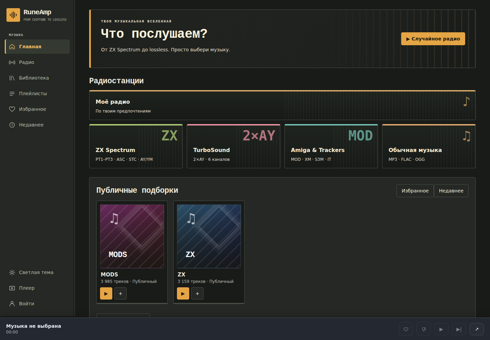
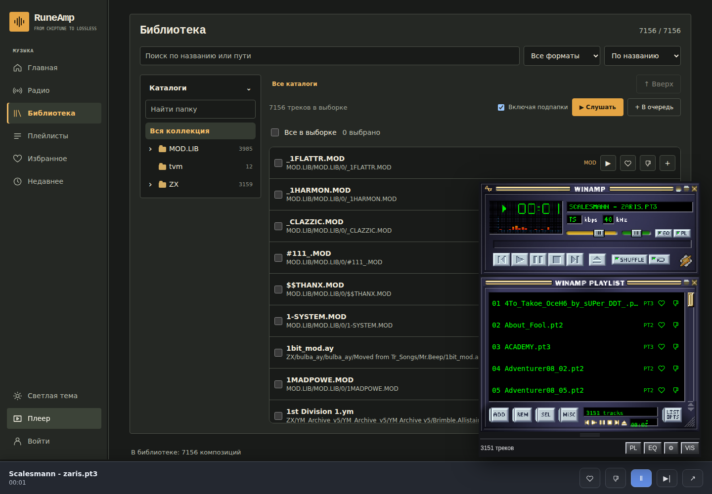

# RuneAmp

**From chiptune to lossless.** Self-hosted музыкальный проигрыватель,
выросший из Runes & Ramparts. Go, SQLite, TypeScript, Web Audio, WebAssembly.
GPL-3.0. Один контейнер, без внешней БД.

## Скриншоты

**Главная страница — Industrial Music Archive**

**Музыкальная библиотека и проигрыватель с классическим Winamp-скином**

## Изменения 0.5.0 — темы музыкального сервиса

[Формат ZIP, создание собственной темы и восстановление заводской](SERVICE-THEMES.md). Темы сервиса независимы от скинов проигрывателя.

## Изменения 0.4.0 — современная музыкальная оболочка

- Новая навигация, отдельные страницы радио, библиотеки, избранного и истории, светлая и тёмная темы.
- Двухпанельная библиотека с деревом каталогов, поиском, фильтрацией форматов, сортировкой и массовыми операциями.
- Карточки плейлистов с локальными обложками, компактный режим, отдельные страницы и поиск по содержимому.
- Файловый менеджер с виртуальными строками, контекстными действиями и единым прогрессом загрузки. Кнопка «Загрузить» автоматически направляет ZIP на импорт, а треки — на обычную загрузку.
- Обновлённые редактор плейлистов и каталог скинов, компактный мобильный интерфейс.
- Существующие скины, проигрыватели и аудиодекодеры сохранены. Проверки Chrome и Firefox на очереди из 100 000 треков.

## Изменения 0.3.4 — переход к текущей композиции

- Двойной щелчок по названию текущего трека в обычном, мини- или Winamp-плеере раскрывает очередь, выделяет композицию и прокручивает список к ней без изменения воспроизведения и Shuffle.
- Enter и пробел на названии выполняют то же действие.

## Изменения 0.3.3 — большие библиотеки и TurboSound

- Рекурсивное добавление выделенных папок и файлов, включая вложенные каталоги; отчёт о добавленных, дубликатах и недоступных композициях.
- Сняты прежние лимиты в 10 000 элементов плейлиста и 100 000 треков библиотеки. Пакетное пополнение, виртуализация очереди, библиотеки, просмотра и редактора плейлистов. HTTP-запросы полного сохранения ограничены 32 МиБ.
- Серверная очередь восстанавливается в браузере; локальные файлы и позиция воспроизведения пока не восстанавливаются. Миграция SQLite не нужна.
- TurboSound: контейнеры 02TS и нативный шестиканальный PT3, два экземпляра WASM PT3-декодера, стерео, отдельное радио. Для существующих коллекций выполните пересканирование. TurboSound FM, 03TS и произвольная перемотка AY пока не поддерживаются.
- Нагрузочные тесты API/SQLite и браузера на 100 000 треков. Проверка реальной коллекции: `node --experimental-strip-types web/tests/turbosound-real.ts /path/to/collection`.

## Возможности 0.5.0

- Рекурсивная библиотека из подключённого каталога, фильтр по папке, поиск, ручное пересканирование.
- Загрузка файлов администратором в выбранную папку основной коллекции (до 256 МиБ на файл); создание папок. Есть режим только чтения с отдельным хранилищем загрузок.
- Локальные файлы с ПК без отправки на сервер (обычное аудио и все браузерные AY/YM-форматы).
- Смешанная очередь, перестановка, удаление, Shuffle, Repeat, публичные и личные серверные плейлисты.
- Гости слушают без входа. Регистрация слушателя: логин и пароль от 6 символов, без почты. Пароли хешируются PBKDF2-HMAC-SHA256 с индивидуальной солью.
- /admin: вход с административным логином/паролем из окружения. Все изменяющие общую библиотеку и публичные плейлисты API защищены на сервере.
- Радио по форматам, случайная музыка, избранное, недавние, персональная подборка по формату и папкам. История и вкусы пока локальны в браузере; личные плейлисты хранятся на сервере.
- Адаптивный интерфейс сервиса и независимый сворачиваемый плеер в стиле Winamp, спектроанализатор, громкость. На ПК окно перетаскивается, на телефоне раскрывается на всю высоту и ширину браузера.
- MP3, FLAC, WAV, OGG/Opus, M4A — прямой поток с HTTP Range, если формат поддерживает браузер.
- PT1/PT2/PT3/STP/ASC/AS0/PSC/SQT/STC — однокристальные AY-модули до 64 КиБ; TurboSound (.ts и шестиканальные .pt3) — до 128 КиБ + 16 байт контейнера, два AY в стерео. PSG/YM/VTX — браузерные дампы AY/YM до 2 МиБ. Для YM и VTX поддерживается LH5.
- MOD/XM/S3M/IT и другие форматы libopenmpt; NSF/SPC/GBS/VGM/VGZ/AY через libgme.
  AAC/AIFF/WMA и неподдерживаемое браузером аудио — FFmpeg. Серверные преобразования
  идут в MP3, не поддерживают произвольную перемотку, ограничены 30 минутами и двумя
  одновременными потоками. Нестандартные модули могут не распознаться.
- Локальные файлы не сохраняются в серверном плейлисте; загрузите их на сервер для постоянного хранения.

## Изменения 0.2.1

- Единая кнопка Play/Pause, синхронная в мини-плеере и основном окне.
- Нравится / не нравится в библиотеке и плеере, избранное и недавнее открываются как список.
- Нейтральная тёмная и светлая тема сервиса; классический серебристый плеер с янтарным дисплеем.
- /playlists: поиск, фильтрация, страницы по 24 списка, содержимое и запуск подборки.
- Административный редактор публичных плейлистов отдельно от текущей очереди: создание, изменение состава и порядка, удаление.
- Обзор реальных папок с количеством файлов и подпапок, отметкой индексации; автоматическое пересканирование после пакетной загрузки.

## Изменения 0.2.2

- Пять встроенных скинов плеера (Silver, Classic, Blue Ice, Violet, Carbon), независимо от темы сайта.
- Визуализатор открывается кнопкой или нажатием на мини-спектроанализатор.
- Шесть режимов: спектр с удержанием пиков, осциллограф, радиальный спектр, спектрограмма, плазма с обратной связью, звёздное поле.
- Пять цветовых схем, автоматическая смена эффектов каждые 20 секунд, полноэкранный режим с браузерным fallback и управление музыкой.
- Анализ реального аудиосигнала всех поддерживаемых форматов через Web Audio; настройки сохраняются в браузере.
- Рисование ограничено примерно 30 кадрами/с и пропускается при скрытых окнах.
- На мобильном визуализатор занимает всё окно браузера.
- Это собственные скины и эффекты; импорт оригинальных .wsz и пресетов MilkDrop пока не реализован.

## Изменения 0.2.3

- Осциллограф использует float PCM, автоусиление и ручные уровни ×1/2/4/8.
- Многоцветные палитры: спектральная, неон и закат; отдельные цвета в спектре, осциллограмме, плазме и других режимах.
- Импорт классических Winamp .wsz/.zip: растровое главное окно, заголовок, кнопки транспорта и цвета плейлиста. Скины хранятся в IndexedDB браузера (до 20, не более 8 МиБ на архив). Остальные элементы RuneAmp остаются адаптивными; не все компоненты Winamp, маски и современные .wal-скины поддерживаются.
- MilkDrop через Butterchurn WebGL 2: 100 встроенных пресетов, переключение с плавным переходом, случайный выбор, автоцикл и импорт .milk через конвертер. Импортированные пресеты доступны до перезагрузки страницы; совместимость произвольных MilkDrop-шейдеров не гарантируется.
- MilkDrop выполняется в отдельном sandbox iframe с непрозрачным origin, без сетевых запросов из пресетов и без доступа к сессии RuneAmp. Основная CSP сохраняется. При отсутствии WebGL 2 используются обычные визуализаторы.
- Лицензии библиотек доступны в /licenses/. MilkDrop загружается только при открытии этого режима.

## Изменения 0.2.4 — ZIP-импорт музыки

- В /admin кнопка «Импорт ZIP», также ZIP можно выбрать в обычной загрузке.
- В выбранной папке создаётся каталог с именем внешнего архива без .zip. Внутренние ZIP раскрываются в той директории, где лежат, без папок по именам вложенных архивов. Настоящая структура директорий с музыкой сохраняется.
- При совпадении итогового относительного пути остаётся первый файл в порядке записей архива; одинаковые имена в разных папках не конфликтуют. Существующий каталог с именем внешнего архива не изменяется: повторный импорт отклоняется.
- Только форматы музыкальной библиотеки, без исходных архивов, картинок, документов и пустых папок. Проверка по расширению и размеру, декодирование конкретного файла при воспроизведении.
- До 2 ГиБ на внешний ZIP, 8 ГиБ суммарно распакованных данных (включая внутренние ZIP), 12 уровней вложенных архивов, 50 000 записей, 256 МиБ на аудиофайл и 64 КиБ на AY-трекерный модуль, 2 МиБ на PSG/YM/VTX. Многотомные архивы, SFX и архивы с ZIP64-каталогом не поддерживаются. Имена UTF-8, для старых не-UTF-8 имён используется CP437.
- Распаковка во временный скрытый каталог на том же файловом разделе; публикация только после успеха, атомарным Linux renameat2 NOREPLACE. Файловая система должна поддерживать эту операцию. При фатальной ошибке (диск, отмена, превышение лимита) незавершённый импорт удаляется; повреждённые вложенные архивы и записи пропускаются. Защита от выхода за корень, ссылок и специальных файлов.
- Индекс обновляется сразу; интерфейс показывает прогресс, количество импортированных треков, архивов, дубликатов и пропущенных файлов, затем пересканирует библиотеку и открывает созданную папку. В режиме read-only импорт идёт в /uploads.
- При использовании reverse proxy увеличьте допустимый размер тела запроса и таймауты для крупных архивов. Серверный таймаут чтения запроса 10 минут. Доступ только администраторам.

## Изменения 0.2.5

- В административном просмотре папок доступны удаление отдельного файла и рекурсивное удаление папки с подтверждением. Удаление окончательное, без корзины.
- Видны и обычные файлы, не входящие в музыкальную библиотеку. Удаление доступно только администратору, с проверкой границ хранилища и режима записи; корень и символические ссылки не удаляются напрямую.
- Индекс и список файлов обновляются сразу. Удалённые треки исчезают из текущей очереди администратора, ссылки на них в сохранённых плейлистах сохраняются, но при запуске подборки отсутствующие файлы пропускаются.

## Изменения 0.2.6 — исправление классических WSZ

- Главное окно импортированного скина занимает всю ширину проигрывателя с сохранением пропорций 275:116. Стандартный дисплей и транспорт RuneAmp в этом режиме скрыты.
- Отрисовка оригинальных спрайтов транспорта, заголовка, часов, шрифта, громкости, перемотки, Shuffle/Repeat, индикатора состояния и цветов спектра; управление через доступные кнопки и ползунки поверх спрайтов.
- Заголовок плейлиста из PLEDIT.BMP, цвета из PLEDIT.TXT, управление очередью через PL. Остальные функции RuneAmp остаются адаптивными.
- Поддержка WSZ всё ещё частичная: эквалайзер, баланс, оригинальные оконные кнопки, полная рамка плейлиста и .wal пока не реализованы. Для перемотки действуют ограничения используемого декодера.
- Проверено с оригинальным base-2.91.wsz на desktop и mobile. Сведения о расположении спрайтов: [Winamp Skin Tutorial](https://winampskins.neocities.org/main), [Webamp](https://github.com/captbaritone/webamp/blob/master/packages/webamp/js/skinSprites.ts).

## Изменения 0.2.7 — устойчивый ZIP-импорт

- Повреждённые или неподдерживаемые вложенные ZIP и отдельные записи с ошибками распаковки/CRC пропускаются. Остальная музыка сохраняется, включая успешно извлечённые файлы до и после ошибки.
- Незавершённые файлы удаляются; при дубликатах сохраняется первый успешно извлечённый файл. Отчёт содержит отдельные счётчики проблемных архивов и файлов и до десяти примеров ошибок.
- Если внешний архив невозможно прочитать или в нём нет исправных поддерживаемых файлов, импорт отклоняется. Ограничения размера, числа записей, глубины, отмена и ошибки диска по-прежнему фатальны.

## Изменения 0.2.8 — компоновка классического Winamp

- В режиме WSZ скрыты собственный заголовок RuneAmp и дублирующий дисплей. Оригинальный заголовок используется для перетаскивания, сворачивания и скрытия плеера; кнопка shade переключает очередь. Скрытие не останавливает музыку.
- Полная рамка плейлиста из PLEDIT.BMP: верх, боковые панели, низ, спрайт прокрутки, оригинальные кнопки ADD/REM/SEL/MISC/LIST и нижние кнопки транспорта. При отсутствии подходящего PLEDIT используется адаптивный редактор.
- Компактные строки очереди с лайком/дизлайком вместо Play; двойной клик или Enter на ПК, касание на сенсорном экране. Путь доступен в подсказке.
- Проверка контрастности цветов текста обычных, выделенных и текущих строк (минимум 4.5:1). Иконки оценок не зависят от emoji-шрифтов.
- Дополнительные действия RuneAmp находятся под плейлистом; выбор/импорт/удаление скина скрыты в меню настроек. Высота очереди меняется нижним правым краем на ПК или клавишами стрелок и запоминается. На мобильном очередь адаптируется к высоте браузера.
- Длинное название прокручивается в дисплее; показываются формат и фактическая частота AudioContext. Битрейт не вычисляется из неизвестных данных.
- Проверено на base-2.91.wsz, тестовом скине с тёмным текстом на тёмном фоне и мобильной эмуляции Chromium. Полноценные EQ, баланс, оригинальный оконный shade-режим и все нестандартные варианты WSZ пока не поддерживаются.

## Изменения 0.2.9 — навигация библиотеки и размер очереди

- Вместо плоского выпадающего списка каталогов — навигация по уровням, хлебные крошки, переход на уровень выше, счётчики треков и поиск вложенных каталогов. По 24 папки на страницу.
- Переключатель «Включая подпапки» определяет состав списка треков и добавления в очередь. По умолчанию сохраняется рекурсивная выборка; фильтры источника и названия продолжают действовать.
- Шрифт очереди увеличен до 14 px. Нижняя кромка плейлиста позволяет менять высоту мышью для WSZ и встроенных скинов; двойной клик переключает максимальную и прежнюю высоту. Стрелки, Home и End также работают. Высота сохраняется локально; на мобильном размер адаптивный.
- Проверено в Chromium на коллекции со 100 вложенными каталогами и настоящем base-2.91.wsz. Отдельное браузерное окно пока не реализовано.

## Изменения 0.2.10 — интерфейс по ролям

- Гость видит музыку, публичные плейлисты, радио, локальные оценки, историю и избранное. Сохранение серверных плейлистов и административные команды скрыты.
- Слушатель дополнительно видит «Мои плейлисты» и может сохранять и удалять собственные подборки. Личные подборки отделены от публичных.
- Администратор видит «Управление», фильтр хранилищ и возможность сохранения публичных плейлистов. Редактирование и удаление публичных подборок выполняются в административном разделе.
- При прямом переходе гостя на /admin доступна форма входа; слушатель возвращается к музыке. При выходе или истечении сессии административный интерфейс скрывается, личные данные интерфейса очищаются. Роль проверяется при возвращении во вкладку и раз в минуту в видимой вкладке.
- Серверные проверки полномочий остаются обязательными независимо от отображения кнопок.

## Изменения 0.3.0 — административный файловый менеджер и общие скины

- Управление разделено на вкладки «Библиотека», «Плейлисты», «Скины» с адресами /admin?tab=library, /admin?tab=playlists и /admin?tab=skins.
- Библиотека: навигация по реальным папкам, хлебные крошки, создание папки, загрузка аудиофайлов, рекурсивный ZIP-импорт и drag-and-drop в текущую папку. Выбор хранилища, поиск и сортировка текущего содержимого.
- Групповое выделение (включая Shift), удаление, перенос через «Переместить сюда», переименование. Перенос только внутри одного хранилища, без перезаписи; расширение отдельного файла не меняется. Групповые операции выполняются поэлементно с отчётом об ошибках.
- При перемещении через RuneAmp сохраняются ID индексированных треков; соответствия путей хранятся в SQLite и восстанавливаются после перезапуска. Внешние перемещения через SSH/Samba не отслеживаются. Файловая система и SQLite не образуют единую атомарную транзакцию при аварийном отключении питания.
- Выбор нескольких треков в обычной библиотеке и админке с добавлением в очередь или напрямую в выбранный плейлист. Выделение сохраняется при переходах по папкам; новый плейлист можно создать прямо в диалоге. Добавление выполняется серверной транзакцией, дубликаты пропускаются, порядок существующих треков сохраняется. Личные плейлисты доступны владельцам, публичные изменяет только администратор. Лимит 10 000 треков на плейлист.
- Серверный каталог классических WSZ/ZIP: загрузка, предпросмотр, скрытие, удаление и выбор скина по умолчанию для новых посетителей. Хранение в SQLite в существующем томе /data (до 100 скинов, 8 МиБ на архив). В плеере доступны встроенные, серверные и локальные скины. Локальный импорт по-прежнему хранится только в браузере. Совместимость WSZ остаётся частичной.
- Новые таблицы БД создаются при запуске; существующие аккаунты, плейлисты и данные сохраняются. Стек не требует изменения.

## Изменения 0.3.2 — дополнительные браузерные AY/YM-форматы

- PT1, ASC (Sound Master 1/2), AS0 (Sound Master 0), PSC, SQT, STC и PSG, YM, VTX добавлены в библиотеку, загрузку, ZIP-импорт, локальный выбор и радио ZX Spectrum.
- 12 расширений воспроизводятся в браузере через WebAssembly, без FFmpeg и серверной перекодировки. Общий звуковой тракт с EQ, балансом и визуализацией сохранён.
- YM: YM3/YM3b и YM5/YM6 без сэмплированных ударных, включая архив LHA level 0 с методом LH5. VTX: старые и новые заголовки AY/YM, LH5. Частота кадров и тактовая частота чипа берутся из заголовка YM5/6 и VTX. Расширенные цифровые эффекты YM не эмулируются; YM2 и нестандартные контейнеры не заявлены.
- Для однокристальных трекеров лимит 64 КиБ, для PSG/YM/VTX — 2 МиБ на файл, до 4 МиБ распакованных данных; воспроизведение ограничено 30 минутами. AY с кодом Z80 по-прежнему использует существующий серверный libgme; FTC, ST1, ST3, TurboSound и прочие варианты в этой версии не добавлены.
- Проверено 22 реальных модуля из тестовой коллекции ZXTune и 12 расширений в Chromium. Синтетические PSG/YM3 тесты входят в CI; пользовательские музыкальные файлы не включены в репозиторий. Проверка PCM не является доказательством побитовой идентичности оригинальному проигрывателю.

## Изменения 0.3.1 — компактный плеер, визуализатор и эквалайзер

- Ширина окна на ПК уменьшена с 530 до 450 px; шрифт очереди сохранён читаемым, высота регулируется как раньше. Мобильный режим адаптивный.
- Команды очереди скрыты под кнопкой PL, настройки под шестерёнкой, EQ и VIS открываются отдельно. Кнопки оригинального WSZ используют те же операции очереди.
- Визуализатор по умолчанию пристыкован сбоку, следует за плеером; на телефоне располагается под ним. Отдельные кнопки переключают режим поверх страницы и полноэкранный режим. MilkDrop остаётся в изолированном iframe.
- Общий звуковой тракт Web Audio для браузерных/серверных потоков и AY: 10 полос 60 Гц–16 кГц, предусилитель ±12 дБ, независимый баланс L/R, отключение EQ, сброс и пресеты. Настройки запоминаются в браузере. При сильном ручном усилении следует уменьшать предусилитель, чтобы избежать клиппинга.
- В классических WSZ поддерживаются EQMAIN.BMP, штатная кнопка EQ и BALANCE.BMP. Если EQMAIN.BMP отсутствует, используется встроенная панель. Автоматические пресеты Winamp (AUTO) не реализованы, вместо них кнопка FLAT.
- Проверено в Chromium на MP3, реальном PT3 и base-2.91.wsz; OfflineAudioContext подтвердил усиление +9 дБ и независимое приглушение каналов. Системные оконные режимы за пределами браузера не добавлены.

## Portainer

Создайте Stack из compose.yaml, задайте переменные:
- MUSIC_PATH — абсолютный путь к каталогу музыки на Docker-хосте (доступ UID 10001 на чтение и запись для загрузки).
- MUSIC_MODE — rw (по умолчанию); для режима только чтения задайте ro и RUNEAMP_MUSIC_WRITABLE=0.
- RUNEAMP_MUSIC_WRITABLE — 1 по умолчанию в Compose, 0 оставляет прежний отдельный /uploads. Старые загрузки из /uploads продолжают отображаться в библиотеке.
- RUNEAMP_SECURE_COOKIE — 1 при работе через HTTPS reverse proxy; для локального HTTP оставить 0.
- RUNEAMP_PASSWORD — собственный сильный пароль администратора, обязателен.
- RUNEAMP_USER — логин (по умолчанию admin).
- RUNEAMP_PORT — порт хоста (8095 по умолчанию).

Образ ghcr.io/mirivlad/runeamp:latest публикуется CI после успешной сборки main.
Если пакет закрыт, авторизуйтесь в GHCR или соберите образ из исходников:

    docker compose -f compose.yaml -f compose.build.yaml up -d --build

Доступ http://IP:8095; посетители не обязаны входить. Административный раздел /admin.
Для доступа через интернет поставьте HTTPS reverse proxy и RUNEAMP_SECURE_COOKIE=1.
Не передавайте пароли по незашифрованному HTTP вне доверенной сети.
В 0.2.0 прежние общие плейлисты становятся публичными; личные плейлисты изолированы по аккаунтам.
Именованные тома /data и /uploads сохраняйте при обновлении.
Административный пароль обязателен даже при публичном доступе к музыке.
При обновлении с 0.1.0 учтите: сервис теперь публичен. Не выставляйте его в интернет, если библиотека должна оставаться частной. Проверьте права на распространение музыки.

## Разработка

Go 1.26+, Node.js 22+, FFmpeg с libopenmpt и libgme.
`cd web && npm ci && npm run build`; затем `go test ./...` и `go build ./cmd/runeamp`.
Задайте RUNEAMP_MUSIC, RUNEAMP_UPLOADS, RUNEAMP_DATA, RUNEAMP_WEB=web/dist и RUNEAMP_PASSWORD.

AY-декодеры перенесены из R&R; исходники и лицензии в third_party/ayfly и third_party/pt3.
Музыкальные композиции в репозиторий не включены.

## Дальнейшее развитие

0.3: перемещение и переименование файлов/папок, безопасное удаление, метаданные.
0.4–0.5: серверная история и избранное, синхронизация профиля вкуса и динамическое персональное радио.
0.6: общий синхронизированный эфир.
0.7+: эквалайзер, скины, расширенные визуализации, PWA и дополнительные форматы.

## Поддержать разработчика / Support development

Если проект оказался полезен, вы можете добровольно поддержать его развитие. / If this project is useful to you, you can voluntarily support its development.

[Страница поддержки / Support page](https://mirv.top/support/)
